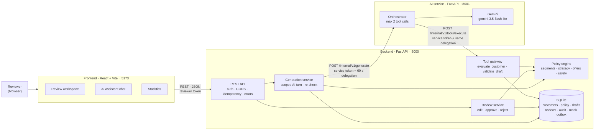
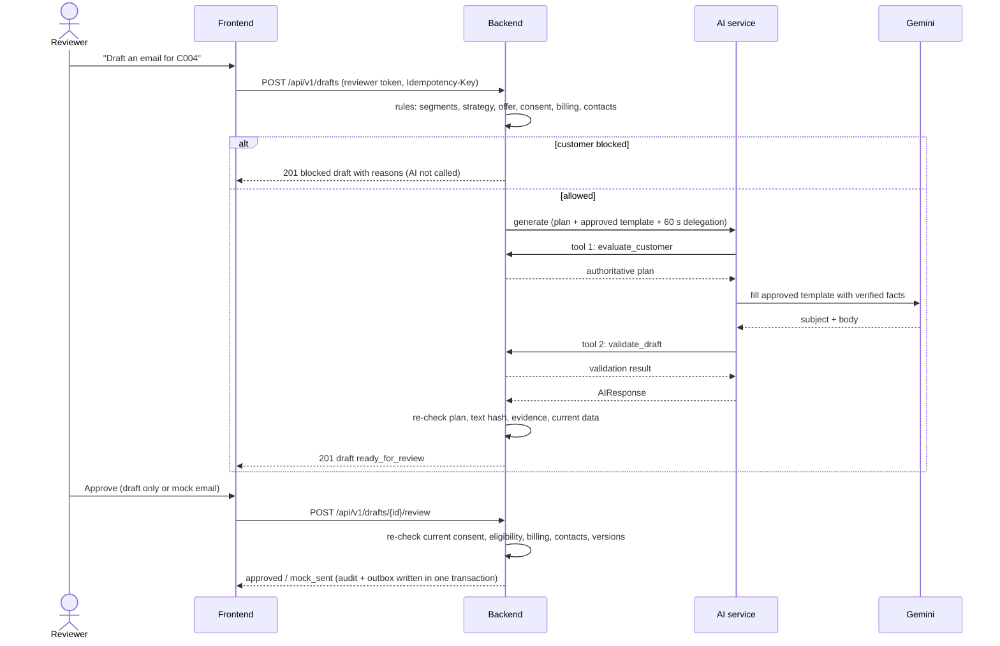

# CodeVortex · LoyaltyAI

**Customer Loyalty and Engagement Assistant** for the HCLTech hackathon (Use case 5).

LoyaltyAI helps a human reviewer send the right message to the right customer. It reads permitted customer data, explains which segment each customer belongs to, chooses an approved strategy and offer with deterministic rules, asks Gemini to write a grounded email from an approved template, and lets the reviewer edit, approve or reject it. Delivery is draft-only or a mock outbox record: **no real email is ever sent**.

| | |
|---|---|
| **Frontend** | React + TypeScript + Vite · [`frontend/`](frontend/README.md) |
| **Backend** | Python FastAPI + SQLite · [`backend/`](backend/README.md) |
| **AI service** | Python FastAPI + Google Gemini (`gemini-3.5-flash-lite`) · [`ai-service/`](ai-service/README.md) |
| **Contract** | Shared, frozen API contract v1.0.0 · [`AI_SERVICE_CONTRACT.md`](AI_SERVICE_CONTRACT.md), [`backend/contracts/`](backend/contracts) |
| **Evaluation** | Live results on 50 labelled synthetic customers · [`EVALUATION.md`](EVALUATION.md) |

---

## Key ideas

1. **Rules decide, AI writes.** Segments, strategy, offer eligibility, consent, billing and contact limits are deterministic backend rules. Gemini only fills an approved email template.
2. **Every AI result is checked twice.** The AI validates its draft through a backend tool, then the backend re-checks everything before saving.
3. **Blocked customers never reach the AI.** No consent, disputed or stale bill, missing evidence or contact limits produce a saved, explained *blocked* draft without a Gemini call.
4. **A human always approves.** Approval re-checks current data; every action is audited.
5. **Least privilege.** The browser talks only to the backend; the AI service gets a signed permission valid for one customer for 60 seconds.

---

## Architecture



The three services run on separate machines connected over a private Tailscale network (frontend `100.117.73.55:5173`, backend `100.83.115.82:8000`, AI service `100.114.163.7:8001`).

| Component | Owns | Never does |
|---|---|---|
| **Frontend** | Reviewer screens, typed API client, idempotency keys, error and retry handling | Call Gemini or the AI service; decide eligibility; store tokens persistently |
| **Backend** | Customer context, all business rules, drafts, review workflow, audit, mock outbox, security | Send real email; trust AI output without re-checking |
| **AI service** | Bounded orchestration: evaluate → Gemini → validate | Hold customer data, make business decisions, write business state |

### How one draft is made



---

## Features

**Backend**
- Explainable segments with evidence: consistent, loyalty candidate, declining activity, dormant, payment reminder
- Strategy priority: payment reminder → re-engagement → reward → appreciation
- Offer eligibility: plan, loyalty points, tenure, active dates, marketing consent, billing priority (each reason recorded)
- Safety checks: consent per objective, email channel, disputed / stale / unknown bills, missing or contradictory evidence, 2 contacts per 7 days, campaign and content de-duplication, blocked phrases, links and identifiers
- Scoped AI turn: immutable 60-second snapshot, signed delegation, exactly two ordered read-only tools, full re-validation before saving
- Human review: template-conforming edits, approve (draft only or mock email), reject; revision numbers prevent stale actions
- Atomic writes: draft, review, audit, outbox and idempotency result commit together or not at all
- Idempotency keys on every POST: retries return the original result instead of duplicates
- SQLite persistence behind a storage interface (in-memory adapter for development)

**AI service**
- One endpoint, `POST /internal/v1/generate`, called only by the backend
- Gemini fills the approved template, temperature 0, prompt `prompt_v1`; untrusted data kept separate from instructions
- Bounded: ≤ 2 tool calls, ≤ 2 Gemini attempts, 22 s per turn; failures return `unavailable` or `504`, never a fabricated draft
- Per-turn telemetry without message text or secrets, and an evaluation script that produces `EVALUATION.md`

**Frontend**
- Review workspace: customer facts, decision and evidence, email preview, edit / approve / reject
- AI assistant: the same workflow as a chat ("Draft an email for C004", "Approve", "Reject wrong tone")
- Statistics for the session: drafts by status, objective and segment, block reasons, timings
- Backend status badge, reviewer token kept in memory only, MSW mock backend for offline demos
- Audit and outbox tab prepared for a proposed contract v1.1, hidden while the backend reports 1.0.0

---

## Security and responsible AI

| Concern | How it is handled |
|---|---|
| Who can use the app | Per-reviewer bearer tokens with an explicit customer allowlist and expiry; no anonymous access |
| Service-to-service calls | Separate secrets for backend → AI and AI → backend; reviewer and service tokens are not interchangeable |
| AI scope | Signed delegation bound to one customer, turn, data/policy/template versions and 60 seconds; only the backend can create it |
| Hallucinations | The AI may only fill approved templates; the backend compares the result with the canonical rendering and real facts |
| Browser access | CORS limited to the frontend origins; internal routes and delegation headers are never browser-accessible |
| Data | Synthetic customers only; no protected attributes in rules; errors never echo customer data or credentials |
| Delivery | Human approval required; mock outbox only; no SMTP, payments, refunds or reward redemption |
| Traceability | Audit record per action with actor, time, request ID and versions; `X-Request-ID` on every response |

---

## Evaluation

From [`EVALUATION.md`](EVALUATION.md), generated by the AI service from real end-to-end turns against the live backend on 31 October 2026 (50 labelled synthetic customers):

| Metric | Result |
|---|---|
| Customers with a recorded turn | 50/50 |
| Objective match | 47/50 (94%) |
| Segment exact match | 42/50 (84%) |
| Expected-pass cases generated | 28/28 (100%) |
| Expected-block cases blocked with the expected codes | 21/22 (95%) |
| Gemini candidates passing `validate_draft` | 29/29 (100%) |
| Model failures / HTTP errors | 0 / 0 |
| Turn latency p50 / max | 2.4 s / 7.9 s |

These are results on a small synthetic set, not a production accuracy claim. See `EVALUATION.md` for per-customer details and the analysis of the mismatches.

**Automated tests**

| Component | Command | Notes |
|---|---|---|
| Backend | `cd backend && python -m pytest -q` | 85 offline tests: contract, auth, storage transactions, policy against labels, boundaries, scripted AI callback flow (83 run in a clean clone; 2 need the private 50-customer dataset) |
| AI service | `cd ai-service && python -m pytest` | Offline: contract examples, schema checks, test doubles for tools and Gemini |
| Frontend | `cd frontend && npm test` | Mock responses match the contract schema; `npm run check:backend` smoke-tests a real backend |

---

## Run it

**Fastest look (no keys needed):** run the frontend with its mock backend.

```bash
cd frontend
npm install
cp .env.example .env          # keep VITE_USE_MOCKS=true
npm run dev                   # http://localhost:5173
```

**Full stack** (Python 3.9+, Node 20.19+, a Gemini API key). Start in this order:

1. **Backend**
   ```bash
   cd backend
   python3 -m venv .venv && .venv/bin/python -m pip install -r requirements-dev.txt
   .venv/bin/python scripts/create_local_env.py      # creates .env with random secrets and a 24 h reviewer token
   echo "STORAGE_BACKEND=sqlite" >> .env              # enables the persistent review workflow
   .venv/bin/python -m uvicorn app.main:create_app --factory --host 127.0.0.1 --port 8000
   ```
   API docs: http://127.0.0.1:8000/docs · health: http://127.0.0.1:8000/health. The public repo ships six synthetic fixture customers (`CUST001`–`CUST006`); the 50-customer evaluation dataset is kept private.
2. **AI service:** copy `ai-service/.env.example` to `.env`, set `AI_SERVICE_TOKEN` and `BACKEND_TOOL_TOKEN` to the same values as the backend `.env`, add `GEMINI_API_KEY`, then run uvicorn on port 8001 (see [`ai-service/README.md`](ai-service/README.md)). Point the backend's `AI_SERVICE_BASE_URL` at it.
3. **Frontend:** set `VITE_USE_MOCKS=false` and `VITE_API_BASE_URL` to the backend URL, `npm run dev`, and paste the reviewer token from `backend/.env` into the app.

Never commit `.env` files; every `VITE_` value ends up in the browser bundle, so tokens are pasted into the UI instead.

---

## API at a glance

| Caller → owner | Endpoint | Purpose |
|---|---|---|
| Anyone → backend | `GET /health` | Liveness and contract version |
| Frontend → backend | `GET /api/v1/customers/{id}/context` | Permitted customer facts |
| Frontend → backend | `POST /api/v1/drafts` | Evaluate and generate (201 new, 200 replay) |
| Frontend → backend | `GET /api/v1/drafts/{id}` | Read a stored draft |
| Frontend → backend | `POST /api/v1/drafts/{id}/review` | Edit, approve or reject |
| Backend → AI | `POST /internal/v1/generate` | One bounded generation turn |
| AI → backend | `POST /internal/v1/tools/execute` | `evaluate_customer`, `validate_draft` |

All bodies are strict JSON; every error uses one `Error` shape with a request ID. Full schemas: [`backend/contracts/schema.json`](backend/contracts/schema.json).

---

## Demo scenarios (50-customer dataset)

| Customer | Expected outcome |
|---|---|
| C001 / C002 | Appreciation (consistent payer) |
| C004 / C005 | Reward with the INR 100 loyalty voucher |
| C008 / C009 | Re-engagement (declining activity) |
| C011 | Re-engagement (dormant) |
| C014 / C015 | Payment reminder |
| C007 | Blocked: no marketing consent |
| C019 | Blocked: billing dispute |
| C023 | Blocked: missing evidence |
| C036 | Blocked: email channel not allowed |

A mock-sent customer is blocked for 7 days by the duplicate-outreach rule, and billing evidence older than 24 hours blocks reminders. Both are intended behaviour.

---

## Repository layout

```
CodeVortex/
├── README.md                 this file
├── AI_SERVICE_CONTRACT.md    shared contract v1.0.0 (AI copy)
├── EVALUATION.md             live evaluation report
├── PLAN.md                   AI service plan
├── frontend/                 React reviewer app (tabs, API client, MSW mocks, tests)
├── backend/
│   ├── app/                  FastAPI app: API, auth, middleware, models
│   │   ├── services/         policy engine, generation, review, tools, AI client
│   │   └── storage/          storage interfaces, in-memory and SQLite adapters, schema
│   ├── contracts/            frozen frontend/AI contracts and JSON Schema
│   ├── fixtures/             synthetic development customers
│   ├── scripts/              env provisioning, database initialisation, contract extraction
│   ├── docs/                 integration and review handoffs
│   └── tests/                pytest suite
└── ai-service/
    ├── app/                  orchestrator, Gemini adapter, tool client, telemetry
    ├── contract/             frozen schema and examples
    ├── scripts/              smoke checks and evaluation
    └── tests/                pytest suite
```

---

## Scope and limitations

- Synthetic data only; results are demo results, not production accuracy.
- Emails follow approved templates; free paraphrasing by the model is intentionally not allowed.
- Single backend worker with SQLite for the demo; the storage interface allows moving to PostgreSQL.
- No login API in v1: reviewer tokens are provisioned by the backend owner.
- Out of scope: real email, bulk outreach, payments, refunds, plan changes, reward redemption and any consent change.

---

**Team CodeVortex** · frontend, backend, AI service and testing built in parallel against one frozen contract.
